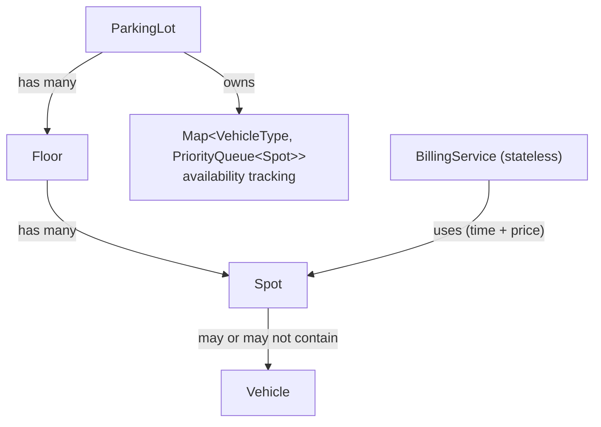

# Design a Parking Lot

<<<SECTION 1>>>
## Overview (Problem statement)

Parking lot with multiple floors, vehicle types (bike, car, truck), spot availability checks, and spot assign/release.

## Entities & Classes

### 1. Vehicle (Base Class + Subtypes)

Inheritance: shared attributes; type drives spot assignment.

```java
public enum VehicleType {
    BIKE, CAR, TRUCK
}

public abstract class Vehicle {
    private String licensePlate;
    private VehicleType type;

    public Vehicle(String licensePlate, VehicleType type) {
        this.licensePlate = licensePlate;
        this.type = type;
    }

    public VehicleType getType() { return type; }
    public String getLicensePlate() { return licensePlate; }
}

public class Car extends Vehicle {
    public Car(String licensePlate) {
        super(licensePlate, VehicleType.CAR);
    }
}

public class Bike extends Vehicle {
    public Bike(String licensePlate) {
        super(licensePlate, VehicleType.BIKE);
    }
}

public class Truck extends Vehicle {
    public Truck(String licensePlate) {
        super(licensePlate, VehicleType.TRUCK);
    }
}
```

### 2. Spot Class

Knows its ID, supported type, and occupancy time.

```java
public class Spot implements Comparable<Spot> {
    private String spotId;
    private VehicleType supportedType;
    private Vehicle currentVehicle;
    private LocalDateTime entryTime;
    private int floorNumber;
    private double pricePerHour;

    public Spot(String spotId, VehicleType supportedType, int floorNumber, double pricePerHour) {
        this.spotId = spotId;
        this.supportedType = supportedType;
        this.floorNumber = floorNumber;
        this.pricePerHour = pricePerHour;
    }

    public boolean isAvailable() {
        return currentVehicle == null;
    }

    public void assignVehicle(Vehicle v) {
        this.currentVehicle = v;
        this.entryTime = LocalDateTime.now();
    }

    public void removeVehicle() {
        this.currentVehicle = null;
        this.entryTime = null;
    }

    public LocalDateTime getEntryTime() { return entryTime; }
    public Vehicle getCurrentVehicle() { return currentVehicle; }
    public String getSpotId() { return spotId; }
    public int getFloorNumber() { return floorNumber; }
    public double getPricePerHour() { return pricePerHour; }
    public VehicleType getSupportedType() { return supportedType; }

    @Override
    public int compareTo(Spot other) {
        return Integer.compare(this.floorNumber, other.floorNumber);
    }
}
```

### 3. Floor Class

Just holds spots; ParkingLot manages availability.

```java
public class Floor {
    private int floorNumber;
    private List<Spot> spots;

    public Floor(int floorNumber) {
        this.floorNumber = floorNumber;
        this.spots = new ArrayList<>();
    }

    public void addSpot(Spot spot) {
        spots.add(spot);
    }

    public List<Spot> getSpots() { return spots; }
    public int getFloorNumber() { return floorNumber; }
}
```

### 4. ParkingLot Class

Holds floors and owns availability tracking:

```java
Map<VehicleType, PriorityQueue<Spot>> availableSpots
```

PriorityQueue orders by floor, so the nearest floor is assigned first: O(log n) fetch and reinsert.

```java
public class ParkingLot {
    private String name;
    private List<Floor> floors;
    private Map<VehicleType, PriorityQueue<Spot>> availableSpots;

    public ParkingLot(String name) {
        this.name = name;
        this.floors = new ArrayList<>();
        this.availableSpots = new HashMap<>();

        for (VehicleType type : VehicleType.values()) {
            availableSpots.put(type, new PriorityQueue<>());
        }
    }

    public void addFloor(Floor floor) {
        floors.add(floor);
        for (Spot spot : floor.getSpots()) {
            availableSpots.get(spot.getSupportedType()).offer(spot);
        }
    }

    public boolean hasAvailableSpot(VehicleType type) {
        return !availableSpots.get(type).isEmpty();
    }

    public Spot assignSpot(Vehicle vehicle) {
        PriorityQueue<Spot> queue = availableSpots.get(vehicle.getType());

        if (queue == null || queue.isEmpty()) {
            throw new RuntimeException("No available spot for vehicle type: " + vehicle.getType());
        }

        Spot spot = queue.poll();
        spot.assignVehicle(vehicle);
        return spot;
    }

    public double releaseSpot(Spot spot) {
        if (spot.isAvailable()) {
            throw new IllegalStateException("Spot is already empty: " + spot.getSpotId());
        }

        LocalDateTime exitTime = LocalDateTime.now();
        double bill = BillingService.calculateBill(spot, exitTime);
        spot.removeVehicle();
        availableSpots.get(spot.getSupportedType()).offer(spot);
        return bill;
    }
}
```

### 5. BillingService Class

Only computes the bill from spot (entry time, price/hour) and exit time.

```java
public class BillingService {

    public static double calculateBill(Spot spot, LocalDateTime exitTime) {
        LocalDateTime entryTime = spot.getEntryTime();
        long minutes = Duration.between(entryTime, exitTime).toMinutes();
        double hours = Math.ceil(minutes / 60.0);
        return hours * spot.getPricePerHour();
    }
}
```

<<<SECTION 2>>>
## Class Relationship Summary



**Aggregation vs Composition:**
- ParkingLot -> Floor, Floor -> Spot: Composition (floors don't exist without the lot)
- Spot -> Vehicle: Aggregation (vehicle exists independently)

## Key design decisions that were imp here

- **Base Vehicle:** no duplication; type is an enum
- **Comparable Spot:** PriorityQueue sorts by floor natively
- **`Map<VehicleType, PriorityQueue<Spot>>`:** O(1) type lookup, O(log n) assignment vs O(n) scan
- **Separate BillingService:** SRP; billing isn't Spot's or ParkingLot's job
- **Dumb Floor:** no availability logic, stays simple
